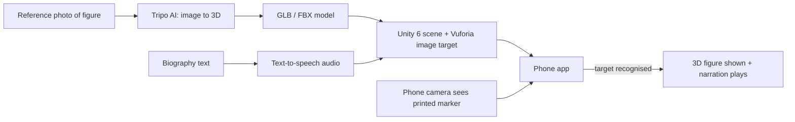
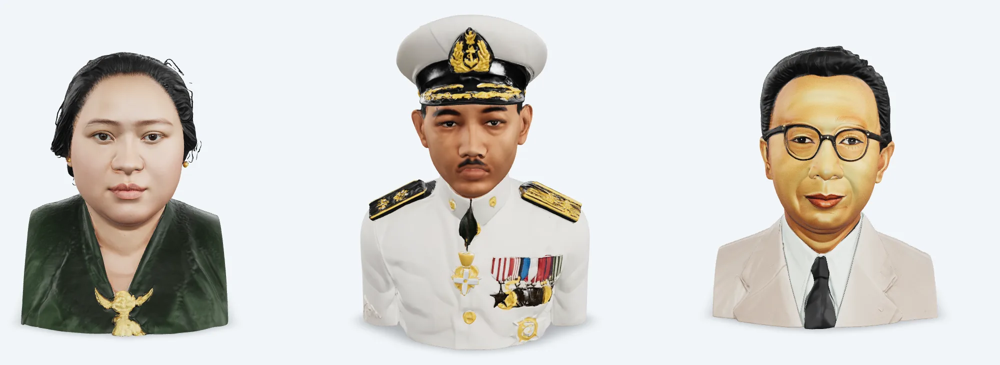

<h1 align="center">WARGIAR</h1>

Marker-based augmented reality that brings Sundanese public figures to life for the "Panggung Inohong" exhibit at Dispusipda Jawa Barat.

> Source is not public (client project). This repository is a showcase only: no Unity project, markers, licence keys or voice-over script are included.

## Overview
The Dinas Perpustakaan dan Kearsipan Daerah (Dispusipda) of West Java presents notable figures of the province in "Panggung Inohong" (Hall of Fame), mostly through text and static visuals. Visitors, especially younger ones, find this passive. WARGIAR adds an AR layer: the visitor points a phone at a printed marker, a 3D figure appears on screen, and a narrated text-to-speech audio plays the figure's biography.

## Features
- Image-target AR with Vuforia Engine: each figure is tied to its own marker.
- 3D figures generated from reference photos with an image-to-3D tool (Tripo AI), exported as GLB/FBX and set up in Unity AR scenes.
- Narrated audio per figure, produced with text-to-speech (one audio file per figure).
- Content set of about 20 figures (20 markers and 20 narration audio files in the working folder).
- Mobile (phone camera) target.

## How it works

## Screenshots
| |
|---|
|  Generated 3D busts of three historical figures (Dewi Sartika, R.E. Martadinata, Djuanda), rendered from the exported models in a web viewer |

## Getting started
Not applicable: the source and assets belong to the client and are not published.

## Project context
Consultation Project course (Proyek Konsultasi), Computer Engineering, UPI Cibiru, 2025. Group project by a team of six, done for Dispusipda Jawa Barat as the partner. I was one of the team members; this is not a solo project.

## Limitations
- Requires printed markers and a phone with a camera; tracking quality depends on lighting and print quality.
- Models are produced by an image-to-3D tool from photos, so likeness and mesh quality vary per figure.
- Source is not public, so the app cannot be rebuilt from this repository.

## License
MIT (applies to this README and documentation only).
